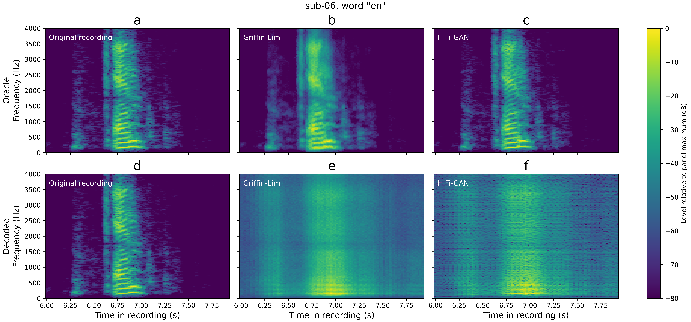

# Speech Decoding from sEEG with Griffin-Lim and HiFi-GAN Synthesis

This repository is a modified version of the code accompanying the *Dataset of Speech Production in intracranial Electroencephalography* (Verwoert et al., 2022). It decodes speech from stereo-electroencephalography (sEEG) recordings.

The original code by the dataset authors is available at [neuralinterfacinglab/SingleWordProductionDutch](https://github.com/neuralinterfacinglab/SingleWordProductionDutch).

## Changes from the original code

### Pipeline structure
- The original scripts (`extract_features.py`, `reconstruction_minimal.py` and `viz_results.py`) have been reorganised into five numbered scripts with a shared data loader and NumPy-style docstrings (see [Running the pipeline](#running-the-pipeline)).
- Participants without results are stored as NaN (not a number) rather than zero, so that missing data cannot be mistaken for a genuine result.
- Random seeds are fixed for the random control and for Griffin-Lim so that results are reproducible.

### Features and decoding
- Spectrograms use 80 Mel bins with 64 ms windows and a 16 ms frameshift, computed with the SpeechBrain pipeline that matches the HiFi-GAN vocoder. The original code used 23 Mel bins with 50 ms windows and a 10 ms frameshift.
- Mel frames are aligned with the intracranial electroencephalography (iEEG) feature windows. SpeechBrain centres its short-time Fourier transform (STFT) frames, so the leading padded frames are removed to give both the same start-anchored framing.
- The decoder itself, principal component analysis (PCA) followed by linear regression in 10-fold cross-validation, is unchanged.

### Audio synthesis
- A pretrained HiFi-GAN (high-fidelity generative adversarial network) vocoder (Kong, Kim and Bae, 2020) from SpeechBrain (Ravanelli et al., 2021), trained on LibriTTS (Zen et al., 2019) at 16 kHz, is used alongside Griffin-Lim (Griffin and Lim, 1984).
- The inverse STFT used by Griffin-Lim no longer amplifies the samples at either end of the signal, which previously produced a large spike at the start or end of each file.

### Evaluation
- Reconstruction correlations are compared with 1,000 circular-shift random controls, with an empirical p-value for each participant (Phipson and Smyth, 2010).
- Vocoded audio is time-aligned with the original recording before evaluation. The alignment accounts for the different frame conventions of the two vocoders and for the padding that SpeechBrain's HiFi-GAN adds. It is verified by envelope cross-correlation.
- Each vocoder is evaluated in an **oracle** condition (ground-truth spectrogram) and a **decoded** condition (predicted spectrogram), which separates the loss caused by the vocoder from the loss caused by decoding.
- Audio quality is measured with short-time objective intelligibility (STOI) as defined by Taal et al. (2011), log-spectral distance (LSD) and Mel-cepstral distance (MCD). LSD and MCD are computed over speech frames only and the two vocoders are compared with Wilcoxon signed-rank tests with Holm-Bonferroni correction (Holm, 1979).
- Electrode coverage of the superior temporal gyrus (STG) and ventral sensorimotor cortex (vSMC) is counted from the Destrieux atlas labels (Destrieux et al., 2010) and related to decoding performance.
- New figures show the acoustic benchmark, waveform comparisons, a close-up spectrogram comparison of both vocoders and the channel coverage analysis.

## Example results

The figures from a full run are included in `results/figures/`.

- **Decoding.** Mean reconstruction correlations range from 0.46 to 0.82 across the ten participants. Eight of the ten exceed all 1,000 circular-shift random controls.
- **Vocoders on the ground-truth spectrogram.** HiFi-GAN produced more intelligible speech than Griffin-Lim (higher STOI for all ten participants), whilst Griffin-Lim reproduced the spectral magnitudes more closely (lower LSD and MCD for all ten participants).
- **Vocoders on the decoded spectrogram.** The two vocoders did not differ significantly on any metric. Most of the quality loss comes from decoding rather than from vocoding.




## Repository structure

```
.
|-- step01_data_loader.py       # loads and checks the iBIDS dataset
|-- step02_extract_features.py  # high-gamma features and log-Mel spectrograms
|-- step03_train_decoder.py     # cross-validated decoding and random control
|-- step04_audio_synthesis.py   # Griffin-Lim and HiFi-GAN synthesis
|-- step05_results.py           # statistics, benchmarks and figures
|-- utilities/
|   |-- MelFilterBank.py        # Mel filterbank used by Griffin-Lim
|   `-- reconstructWave.py      # STFT, inverse STFT and Griffin-Lim
|-- results/
|   `-- figures/                # figures from a full run
|-- load_data.m                 # MATLAB loading example from the original authors
|-- requirements.txt
`-- LICENSE
```

## Getting the data

The dataset is not included in this repository. It is stored in the iEEG Brain Imaging Data Structure (iBIDS) format and can be downloaded from the Open Science Framework (OSF):

1. Go to [https://osf.io/nrgx6](https://osf.io/nrgx6/) and download the `SingleWordProductionDutch-iBIDS` folder.
2. Place the folder in the root of this repository, next to the step scripts.

The scripts expect the following structure:

```
SingleWordProductionDutch-iBIDS/
|-- participants.tsv
|-- sub-01/
|   `-- ieeg/
|       |-- sub-01_task-wordProduction_ieeg.nwb
|       |-- sub-01_task-wordProduction_channels.tsv
|       |-- sub-01_task-wordProduction_space-ACPC_electrodes.tsv
|       `-- ...
|-- sub-02/
|   `-- ...
`-- sub-10/
```

Please cite Verwoert et al. (2022) if you use the dataset.

## Installation

The pipeline was developed and tested on Windows with Python 3.14.6.

```bash
python -m venv .venv

# Windows (Git Bash)
source .venv/Scripts/activate

# macOS / Linux
source .venv/bin/activate

pip install -r requirements.txt
```

On Windows, `pip install` installs the central processing unit (CPU) version of PyTorch. To run HiFi-GAN on a graphics processing unit (GPU), install the CUDA build of `torch` and `torchaudio` from [pytorch.org](https://pytorch.org/get-started/locally/) first, using the versions in `requirements.txt`.

The HiFi-GAN checkpoint ([speechbrain/tts-hifigan-libritts-16kHz](https://huggingface.co/speechbrain/tts-hifigan-libritts-16kHz)) is downloaded automatically into `pretrained_models/` the first time step 4 runs, so an internet connection is needed for that run.

## Running the pipeline

Run the scripts in order from the repository root. Each step reads the outputs of the steps before it.

```bash
python step01_data_loader.py
python step02_extract_features.py
python step03_train_decoder.py
python step04_audio_synthesis.py
python step05_results.py
```

| Step | Script | What it does | Output |
|---|---|---|---|
| 1 | `step01_data_loader.py` | Loads the dataset, checks every participant (sampling rates, channel counts, invalid values, dead channels) and plots diagnostic figures for sub-01 | Console summary and diagnostic plots |
| 2 | `step02_extract_features.py` | Extracts high-gamma (70-170 Hz) features, adds temporal context and computes 80-bin log-Mel spectrograms | `features/` |
| 3 | `step03_train_decoder.py` | Decodes the spectrogram with PCA (50 components) and linear regression in 10-fold cross-validation and computes the random control | `results/` |
| 4 | `step04_audio_synthesis.py` | Synthesises audio from the ground-truth and predicted spectrograms with Griffin-Lim and HiFi-GAN | `results/audio/` |
| 5 | `step05_results.py` | Runs the statistical tests and acoustic benchmarks and creates all figures | `results/figures/` and console tables |

Step 1 only inspects the data, so it can be skipped once the dataset has been checked.

Steps 1 and 5 open each figure in a window. Close the window to let the script continue.

## Outputs

`step05_results.py` saves the following figures to `results/figures/`:

| File | Content |
|---|---|
| `results.png` | Mean reconstruction correlation per participant and per Mel bin, with chance levels from the random control |
| `channel_coverage_analysis.png` | Distribution of decoder weights across channels and decoding performance against STG/vSMC electrode coverage |
| `acoustic_benchmarking_hifigan_vs_gl.png` | STOI, LSD and MCD for Griffin-Lim and HiFi-GAN in the oracle and decoded conditions |
| `spec_example.png` | Original and reconstructed spectrograms for five words |
| `wav_example_comparison.png` | Original waveform and the decoded Griffin-Lim and HiFi-GAN waveforms for the same words |
| `vocoder_closeup.png` | Spectrograms of one word from the original recording and both vocoders in both conditions |

## Notes and limitations

- **Chance level.** Each trial consists of exactly 2 s of word presentation followed by 1 s of fixation, so circular shifts close to a multiple of 3 s realign speech with speech. The circular-shift control is therefore strict and not every participant exceeds all 1,000 shifts.
- **Channel importance.** Channel importance is the mean magnitude of the decoder weights. Weights of a linear decoder do not directly show which channels carry speech information (Haufe et al., 2014), so these values should be interpreted with caution.
- **Electrode coverage.** sub-06 has far more STG/vSMC electrodes than any other participant, so it has a strong influence on the correlation between coverage and decoding performance.
- **MCD values.** MCD is computed from natural-log Mel spectra with an orthonormal discrete cosine transform (DCT) over 80 bins. Values are comparable within this project but not with MCD values computed from Speech Signal Processing Toolkit (SPTK) Mel-cepstra in the speech synthesis literature.
- **Highest Mel bins.** The audio is downsampled from 48 kHz to 16 kHz with an anti-aliasing filter that removes most energy above about 6.4 kHz, so correlations drop in the highest Mel bins.
- **HiFi-GAN.** The vocoder is pretrained on English read speech (LibriTTS) and is not fine-tuned on decoded spectrograms.
- **vSMC definition.** The Destrieux atlas does not divide the sensorimotor cortex into ventral and dorsal parts, so precentral, postcentral and central sulcus contacts count as vSMC only at or below an anterior commissure-posterior commissure (ACPC) z-coordinate of 40 mm.

## References

### Background

Papers on speech decoding and the cortical representation of speech that informed the design of this pipeline.

- Anumanchipalli, G.K., Chartier, J. and Chang, E.F. (2019) ‘Speech synthesis from neural decoding of spoken sentences’, Nature, 568(7753), pp. 493–498. Available at: https://doi.org/10.1038/s41586-019-1119-1.
- Bouchard, K.E. et al. (2013) ‘Functional organization of human sensorimotor cortex for speech articulation’, Nature, 495(7441), pp. 327–332. Available at: https://doi.org/10.1038/nature11911.
- Chartier, J. et al. (2018) ‘Encoding of Articulatory Kinematic Trajectories in Human Speech Sensorimotor Cortex’, Neuron, 98(5), pp. 1042-1054.e4. Available at: https://doi.org/10.1016/j.neuron.2018.04.031.
- He, T. et al. (2025) ‘VocalMind: A Stereotactic EEG Dataset for Vocalized, Mimed, and Imagined Speech in Tonal Language’, Scientific Data, 12(1), p. 657. Available at: https://doi.org/10.1038/s41597-025-04741-2.
- Liu, Y. et al. (2023) ‘Decoding and synthesizing tonal language speech from brain activity’, Science Advances, 9(23), p. eadh0478. Available at: https://doi.org/10.1126/sciadv.adh0478.
- Mesgarani, N. et al. (2014) ‘Phonetic Feature Encoding in Human Superior Temporal Gyrus’, Science, 343(6174), pp. 1006–1010. Available at: https://doi.org/10.1126/science.1245994.
- Metzger, S.L. et al. (2023) ‘A high-performance neuroprosthesis for speech decoding and avatar control’, Nature, 620(7976), pp. 1037–1046. Available at: https://doi.org/10.1038/s41586-023-06443-4.
- Silva, A.B. et al. (2024) ‘The speech neuroprosthesis’, Nature Reviews Neuroscience, 25(7), pp. 473–492. Available at: https://doi.org/10.1038/s41583-024-00819-9.
- Zhang, D. et al. (2024) ‘A brain-to-text framework for decoding natural tonal sentences’, Cell Reports, 43(11), p. 114924. Available at: https://doi.org/10.1016/j.celrep.2024.114924.
- Zhang, H. et al. (2026) ‘A Fine-grained Spatiotemporal ECoG Dataset during Speech Perception in Tonal Language’, Scientific Data, 13(1), p. 1380. Available at: https://doi.org/10.1038/s41597-026-07619-z.

### Methods and software

The dataset, methods and tools that the code directly uses.

- Destrieux, C. et al. (2010) ‘Automatic parcellation of human cortical gyri and sulci using standard anatomical nomenclature’, NeuroImage, 53(1), pp. 1–15. Available at: https://doi.org/10.1016/j.neuroimage.2010.06.010.
- Griffin, D. and Lim, J. (1984) ‘Signal estimation from modified short-time Fourier transform’, IEEE Transactions on Acoustics, Speech, and Signal Processing, 32(2), pp. 236–243. Available at: https://doi.org/10.1109/TASSP.1984.1164317.
- Haufe, S. et al. (2014) ‘On the interpretation of weight vectors of linear models in multivariate neuroimaging’, NeuroImage, 87, pp. 96–110. Available at: https://doi.org/10.1016/j.neuroimage.2013.10.067.
- Holm, S. (1979) ‘A Simple Sequentially Rejective Multiple Test Procedure’, Scandinavian Journal of Statistics, 6(2), pp. 65–70. Available at: https://doi.org/10.2307/4615733.
- Kong, J., Kim, J. and Bae, J. (2020) ‘HiFi-GAN: Generative Adversarial Networks for Efficient and High Fidelity Speech Synthesis’. arXiv. Available at: https://doi.org/10.48550/arXiv.2010.05646.
- Phipson, B. and Smyth, G.K. (2010) ‘Permutation P-values should never be zero: calculating exact P-values when permutations are randomly drawn’, Statistical Applications in Genetics and Molecular Biology, 9, Article 39. Available at: https://doi.org/10.2202/1544-6115.1585.
- Ravanelli, M. et al. (2021) ‘SpeechBrain: A General-Purpose Speech Toolkit’. arXiv. Available at: https://doi.org/10.48550/arXiv.2106.04624.
- Taal, C.H. et al. (2011) ‘An Algorithm for Intelligibility Prediction of Time–Frequency Weighted Noisy Speech’, IEEE Transactions on Audio, Speech, and Language Processing, 19(7), pp. 2125–2136. Available at: https://doi.org/10.1109/TASL.2011.2114881.
- Verwoert, M. et al. (2022) ‘Dataset of Speech Production in intracranial Electroencephalography’, Scientific Data, 9(1), p. 434. Available at: https://doi.org/10.1038/s41597-022-01542-9.
- Zen, H. et al. (2019) ‘LibriTTS: A Corpus Derived from LibriSpeech for Text-to-Speech’. arXiv. Available at: https://doi.org/10.48550/arXiv.1904.02882.

## Licence

The original code was released by the Neural Interfacing Lab under the MIT License and this repository keeps the same licence (see `LICENSE`). Modifications by Haseeb Ahmad Irshad.

## Acknowledgements

I would like to thank the Advanced Biomedical Instrumentation Centre and my supervisors for their support on this project.